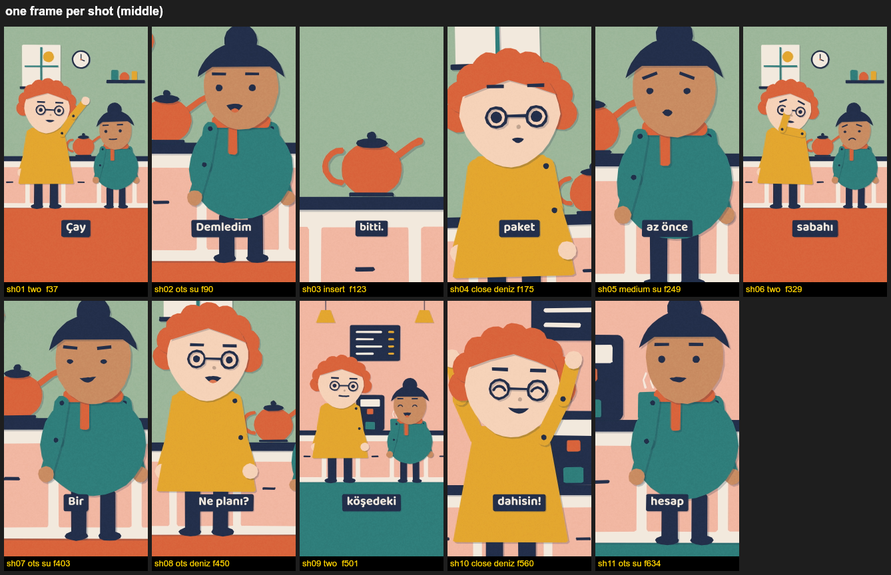
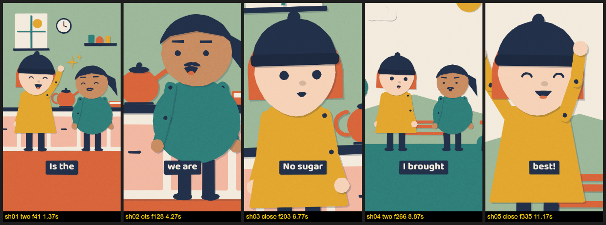
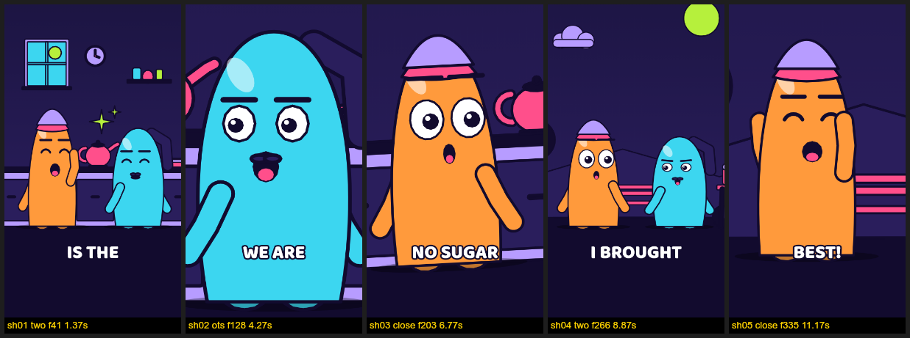
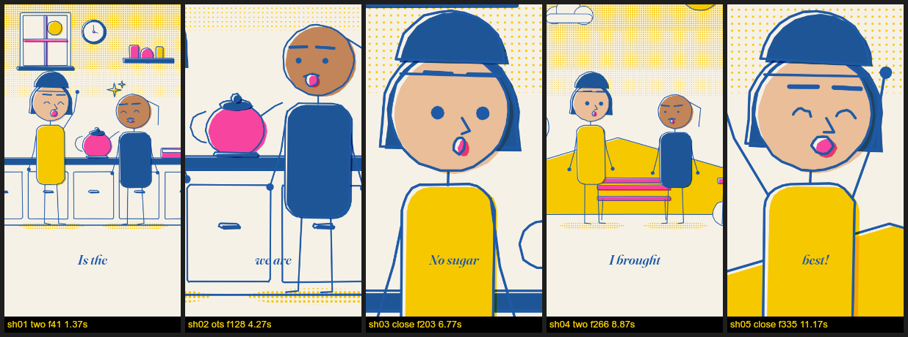

# dialogue-animator

**Write a dialogue, get an animated video.** Make a folder, put your script in it and add whatever else you have: narration, voice recordings, sound effects, music, character notes. This skill stages it. It produces 2D characters, camera work, lip-sync, expressions, gestures, captions, an original music bed, a broadcast-loudness mix and an automatic QA report. Default output: 9:16, 1080×1920, 30 fps, H.264 + AAC.

It is an **agent skill that works with any model or agent**: Claude Code, Codex, Gemini CLI, Cursor, or you in a terminal. The agent does not need to be clever about video: it runs one command, `da next`, does what it prints, and repeats until it prints DONE. A test in this repository does exactly that with no judgment at all. Everything runs locally with Node and ffmpeg and needs no browser or cloud service.



*Example: [`examples/cay-krizi`](examples/cay-krizi), a 23 s Turkish dialogue in the default "Kesik Kâğıt" (paper cut) style. 11 shots, two scenes, per-line audio, synthesized music, QA: PASS. Video: [`output/cay-krizi_540p.mp4`](examples/cay-krizi/output/cay-krizi_540p.mp4).*

## Quick start (5 minutes)

You need **Node.js 20+** and **ffmpeg** (`winget install Gyan.FFmpeg` · `brew install ffmpeg` · `sudo apt install ffmpeg`, or `pip install imageio-ffmpeg`).

```bash
git clone https://github.com/ozguryrr-design/dialogue-animator.git
cd dialogue-animator
npm install
node bin/da.mjs doctor                       # checks Node, canvas, ffmpeg, fonts
node bin/da.mjs make examples/cay-krizi      # renders the example (~15 s on a laptop)
```

The video lands in `examples/cay-krizi/out/cay-krizi.mp4`, and the QA report in `examples/cay-krizi/build/qa/report.md`.

Your own video:

```bash
node bin/da.mjs init my-video     # makes audio/, sfx/, music/, characters/ and a README.txt
# write your script to my-video/dialogue.md, add your files (see below)
node bin/da.mjs next my-video     # says what to do next; repeat until it prints DONE
```

## Bring your own

Make a folder and put in it what you have. **Only the script is required.** Give nothing else and the agent asks what it needs (style, format, captions, music, voice) and makes the video; every question has a default. Have files to add and want the folders made for you? Ask the agent, or run `da init my-video`.

```
my-video/
  dialogue.md     the script: dialogue, narration and sound cues
  audio/          voices, narration included
  sfx/            your sound effects
  music/          your music
  characters/     what your characters look like
```

| you have | put it in | and |
|---|---|---|
| **Dialogue** | `dialogue.md` | One utterance per line: `Ali: Is the tea gone? [surprised]` |
| **Narration** | `dialogue.md` | `Narrator: It was morning.` or `Anlatıcı: …`. Any other name: add `@narrator Grandpa` once. It is heard and nobody on screen says it; while it plays the camera looks around the scene. A scene with only narration has an empty stage, and `@cast Ali, Su` puts people on it. `Ali (voice-over): …` is a character heard but not seen speaking. |
| **Voices** | `audio/` | Best: one numbered file per spoken line, narration included, in script order: `01_narrator.wav`, `02_ali.wav`, `03_su.wav`. One file for everything also works (with whisper or silence detection), and so does no audio (timing is then estimated and clearly flagged). |
| **Sound effects** | `sfx/` | `sfx/thunder.wav` plays where the script says `@sfx thunder`, just before the next line. `@sfx thunder 12.5 -3dB` plays it at 12.5 s, 3 dB quieter. Built in, no file needed: `door`, `bolt`, `clink`, `knock`, `whoosh`; a file with one of those names replaces it. |
| **Music** | `music/` | One file you have the rights to. It is looped, faded and ducked under speech. With no file, original music is generated. To have none: `da answer my-video --music none`. |
| **Characters** | `characters/` | `ali.md` ("tall, curly ginger hair, glasses"), `ali.png` (colours are taken from it) or `ali.json` (exact). Otherwise they are generated from the script. |

```markdown
# The Lost Key

## Park
Narrator: Nobody had been to the park in years.
@sfx wind
@cast Ali, Su
Ali: Is that... a key? [surprised]
Su: (shrugs) Just an old one.
```

Everything else (scene names, expression tags, timed scripts with stage directions): [docs/PROJECT_FOLDER.md](docs/PROJECT_FOLDER.md). Any language works; `doctor` checks that the fonts cover every character you used.

## Use it as a skill

Tell your agent: *"Follow SKILL.md in the dialogue-animator folder and make the video in my-video/."*

- **Claude Code**: copy or clone this folder to `~/.claude/skills/dialogue-animator/` (or a project's `.claude/skills/`). Then just ask for "an animated dialogue video from my-video/".
- **Other agents** (Codex, Gemini CLI, Cursor, Aider …): open this folder. `AGENTS.md`, `CLAUDE.md` and `GEMINI.md` all lead to `SKILL.md`.
- **Why any model can do it:** the order of the steps, the checks and the defaults live in `da next`, not in the model's head. It looks at the folder and answers with one thing to do: run this command, ask these questions, write this file, or done. The model can lose its place or forget everything; the next `da next` still knows where things stand and only redoes what changed. `--json` gives the same answer as data.
- It asks at most a few short questions (style, format, captions, and music or voice if it cannot tell), each with a default. Agents that cannot ask take the defaults, and every assumption is written to `build/decisions.md`.

## Styles
Three original style packs ship. All of them are measurable and switchable, and you can write your own ([docs/STYLE_PACK.md](docs/STYLE_PACK.md)).

| `kesik-kagit` (default) | `jole` | `riso-cizgi` |
|---|---|---|
|  |  |  |
| Cut paper, no outlines, layer shadows, characters on twos | Thick outlines, glossy blobs, squash-and-stretch, punch-ins | Blue monoline, off-register pink and yellow, halftone |

```bash
node bin/da.mjs styles                              # list
node bin/da.mjs style new my-look --from jole       # copy and edit numbers
node bin/da.mjs style check my-look                 # contrast, colour count, limits, Turkish glyphs
node bin/da.mjs style preview my-look               # preview sheet
```

## How it works
```
dialogue.md ─parse─▶ dialogue.json ─cast─▶ characters.json
audio/ ─────align─▶ timing.json + voice.wav + mouth envelopes
                      └──────────── board (director) ─▶ storyboard.json ◀── the only input a renderer needs
                                                             │
          render (Canvas2D in Node; frames piped to ffmpeg) ─┤─ preview (same engine in a browser)
                                                             │
                       mix (music ducked, −14 LUFS) ─▶ out/<title>.mp4 ─▶ qa (report + contact sheets)
```
- **Story is separate from the renderer.** The director writes `storyboard.json` (scenes, cast positions, shots, camera moves, expression/gesture/reaction events, mouth tracks, captions), and the renderer only reads it. A pure `renderFrame(ctx, env, t)` runs unchanged in Node (`@napi-rs/canvas`), a browser preview, or Playwright ([docs/RENDERERS.md](docs/RENDERERS.md)).
- **Everything is timed to words.** Cuts land 4 frames before the speaker's first syllable, and listeners react 4 frames before the word they react to. No hold is static, a framing is never repeated back to back, and long lines get reaction cuts ([docs/DIRECTING.md](docs/DIRECTING.md)).
- **QA any model can read**: black, white and frozen frames, pops, loudness, true peak, audio/storyboard sync in frames, captions in the safe area and off faces, speaker faces never cut, and shot rhythm. Contact sheets are made for models that can see images ([docs/QA.md](docs/QA.md)).

## Commands
| | |
|---|---|
| `next <dir> [--json]` | **start here**: the one thing to do next |
| `answer <dir> --style … --captions … \| --defaults` | store your choices in `project.json` |
| `doctor [dir]` | check tools, fonts and a project folder |
| `init <dir> [--sample]` | prepare the folders (never touches your script); `--sample` adds a sample script |
| `parse` · `cast` · `align` · `board` | the pipeline steps (each writes JSON in `build/`) |
| `stills <dir> [--t 1.5,4] [--scale 1]` | one PNG per shot (or per time) + a sheet |
| `render <dir> [--scale 0.5] [--workers 6]` | the picture (no frame folders on disk) |
| `music` · `mix` | original music bed; ducking, loudness, mux |
| `qa <dir>` | report + sheets; exit code 1 on FAIL |
| `make <dir>` | everything above, non-interactive |
| `babble <dir>` | gibberish voice per line when there is no recording |
| `preview <dir>` | live preview in a browser |
| `compare --a … --b …` · `sheet <video>` · `clean <dir>` | review and housekeeping tools |

Run them as `node bin/da.mjs …`, or `npm link` once and use `da …`.

## Docs
[PROJECT_FOLDER](docs/PROJECT_FOLDER.md) · [QUESTIONS](docs/QUESTIONS.md) · [CHARACTERS](docs/CHARACTERS.md) · [DIRECTING](docs/DIRECTING.md) · [AUDIO](docs/AUDIO.md) · [STYLE_GUIDE](docs/STYLE_GUIDE.md) · [STYLE_PACK](docs/STYLE_PACK.md) · [STORYBOARD_SCHEMA](docs/STORYBOARD_SCHEMA.md) · [RENDERERS](docs/RENDERERS.md) · [QA](docs/QA.md) · [TROUBLESHOOTING](docs/TROUBLESHOOTING.md)

## Licence and assets
- Code and docs: **MIT** ([LICENSE](LICENSE)).
- Fonts: Baloo 2, Fraunces and Noto Sans, **SIL OFL 1.1**, unmodified, with their licences in `fonts/`.
- Characters, sets, props, symbols, the example's voice (babble synthesis) and all music are **generated by code in this repository**. There are no samples, stock art or third-party characters. The style packs are original directions, not copies of any channel or brand.
- Music or voices you add yourself remain your responsibility.

---

## Türkçe hızlı başlangıç

**Metni yaz, animasyonlu videoyu al.** Bir klasör açın, metninizi koyun ve elinizde ne varsa ekleyin: dış anlatım, ses kayıtları, ses efektleri, müzik, karakter tarifleri. Sahneler, kamera, ağız senkronu, ifadeler, altyazı, ses miksajı ve kalite kontrolü otomatik yapılır.

Yapay zekâ ajanınıza şunu söylemeniz yeterli: *"dialogue-animator klasöründeki SKILL.md'yi izle ve benim-videom klasöründeki videoyu yap."* Hangi model olursa olsun aynı şekilde çalışır: ajan `da next` komutunu çalıştırır, yazanı yapar ve DONE görene kadar tekrar eder.

```bash
npm install
node bin/da.mjs make examples/cay-krizi      # örnek videoyu üretir
node bin/da.mjs init benim-videom            # audio/, sfx/, music/, characters/ klasörlerini hazırlar
node bin/da.mjs next benim-videom            # sıradaki tek adımı söyler; DONE görene kadar tekrarla
```

**Yalnızca metin zorunludur.** Başka hiçbir şey vermeseniz de ajan gerekenleri sorar (stil, format, altyazı, müzik, ses) ve videoyu üretir; her sorunun varsayılanı vardır. Klasörlerin hazırlanmasını isterseniz ajana söylemeniz ya da `da init benim-videom` çalıştırmanız yeterli. Elinizde varsa:

| elinizdeki | nereye | nasıl |
|---|---|---|
| **Diyalog** | `dialogue.md` | Her satıra `İsim: cümle`. `[şaşkın]` ifadeyi, `(omuz silker)` jesti belirler, `## Mutfak` yeni sahne açar. |
| **Dış anlatım** | `dialogue.md` | `Anlatıcı: O sabah kimse yoktu.` Başka bir ad için bir kez `@narrator Dede` yazın. Duyulur, ekranda kimse söylemez; kamera bu sırada sahnede gezinir. Karakterin içinden geçenler: `Ali (dış ses): …` |
| **Ses kayıtları** | `audio/` | En iyisi, dış anlatım dahil konuşulan her satıra metindeki sırayla numaralı bir dosya: `01_anlatici.wav`, `02_ali.wav`. Tek dosya da olur. Hiç ses yoksa zamanlama tahminidir ve raporda belirtilir. |
| **Ses efektleri** | `sfx/` | `sfx/gok-gurultusu.wav` dosyası, metinde `@sfx gök gürültüsü` yazan yerde, sonraki satırdan hemen önce çalar. `@sfx gök gürültüsü 12.5 -3dB`: 12.5. saniyede, 3 dB daha kısık. Dosyasız hazır sesler: kapı, sürgü, kilit, tıkırtı, tıklama, hışırtı. |
| **Müzik** | `music/` | Hakkına sahip olduğunuz tek dosya. Döngüye alınır, konuşmanın altında kısılır. Dosya yoksa özgün müzik üretilir, hiç istemiyorsanız: `da answer benim-videom --music none`. |
| **Karakterler** | `characters/` | `ali.md` içine "uzun boylu, kıvırcık kızıl saçlı, gözlüklü" gibi bir tarif; yoksa metinden otomatik üretilir. |

- **Ayarlar:** `da next` stil, format ve altyazıyı sorar. Elle: `da answer benim-videom --style jole --format 16:9 --captions line`. Sorulmayan her şeyin varsayılanı vardır; kullanılanlar `build/decisions.md` dosyasına yazılır.
- **Zamanlı akış:** `0–5 sn — Kapı kapanır.` gibi satırlar konuşmaları o aralığa yerleştirir ve yönergeleri oynatır.
- **Stiller:** `kesik-kagit` (varsayılan), `jole`, `riso-cizgi`. Kendi stilinizi `node bin/da.mjs style new benim-stilim --from kesik-kagit` ile türetebilirsiniz.
